# CSRS — customer segmentation and retail analytics

Current local dashboard: **http://localhost:4000/CSRS/**.

Render/GitHub deployment uses the verified snapshot in [`deployment/current`](deployment/current), including the current database archive, figures and evaluation evidence. See [deployment instructions](deployment/README.md). Historical run folders remain local; the pre-update main is preserved on `older-version`, and the current release is recorded on `updated` before promotion to main.

Current executed run: **`model/pipeline b/repair_outputs_2026-10-23/named_20261025_214151/`**. This supersedes the purchaser-only run `run_20261025_113044`; old outputs and documentation remain preserved. Hosted deployment follows its own deployment state.

Read [the current model review](CURRENT_MODEL_REVIEW_2026-10-25.md), [brief identity/migration explanation](CLUSTER_IDENTITY_AND_MIGRATION.md), [MDFCM implementation status](MDFCM_PAPER_IMPLEMENTATION_STATUS.md), and [rebuild instructions](model/pipeline%20b/MODEL_REBUILD.md).

## Methodology

1. **Data cleaning:** exact-row deduplication, valid linked customer IDs/invoices/dates, positive finite quantity/price, cancellation exclusions and explicit missing-description/country placeholders.
2. **Customer snapshots:** every customer observed before each cutoff; uncapped recency; one exact trailing 90-day purchase window. C0 covers December 2010–February 2011; C1–C9 end monthly March–November.
3. **Cascaded RFM:** derive R, distinct paid invoices /3 and positive paid sales /3; apply log1p to each and form RF, RM and FM products of logged values.
4. **MinMax scaling:** fit on C0 only and reuse.
5. **PCA:** fit three components on C0 only and reuse in every cycle.
6. **Static C0 K-means:** accepted WCSS elbow K=5; silhouette supporting evidence. Validation includes inertia (WCSS), silhouette, Davies–Bouldin and Calinski–Harabasz. Inertia is 56.5713. FCM does not run in C0.
7. **Dynamic C1–C9 MDFCM:** update all observed customer snapshots, including non-purchasers. Replace old observations before adding current ones; carry-over mass is zero and prior centres initialize the next fit. Preserve the FCM equations and MDFCM condition-permitted K−1/K/K+1 comparisons; choose lowest converged finite Xie–Beni. Membership concentration, hard-label metrics and actual centre movement are reported.
8. **Geographic integration:** separate specified K=3 country-market K-means, baseline RobustScaler/fixed later centres and 90-day commercial features with broad behavioural-family composition; derive customer–market combinations.

The study contains **375,666 paid-sale rows, 4,297 customers and 30,280 customer-cycle observations**. Model F/M are rolling monthly equivalents. Separate disjoint commercial totals reconcile to **£8,370,018.454 and 17,754 orders**; rolling windows are never summed as extra revenue. Lifetime history establishes observed customers and the latest purchase, rather than replacing rolling spend.

## Results and interpretation

Fitted K for C0–C9 is **5,5,5,5,5,6,6,7,8,9**. Each fitted centre has a distinct registry entry and display label. Allowed profile hierarchy: Champions; High-Value Regulars; Loyalists; Valuable Customers at Risk; Mid-Tier Occasionals; Occasional Buyers at Risk; Light Buyers; Light Buyers at Risk; Hibernating / Lost. Use names only where supported; an ID/centre qualifier preserves an additional genuine centre instead of forcing an unsupported category.

Names describe weighted RFM; individual customer warnings are separate. At risk: 31–60 days or observed deterioration; Slipping: 61–90; Lost: >90. Hibernating / Lost remains one cluster category. Non-purchasers receive updated RFM and fresh memberships in every cycle.

Cycle 9 full-population silhouette is 0.476 and mean maximum membership 68.5%. Current-month purchasers have 0.233 and 52.1%; dormant observations raise headline scores. No probability of a correct customer type or causal campaign improvement is claimed. K increases are data-driven; no research-cycle K−1 condition occurs. Synthetic branch checks are separate.

Cluster tracking IDs and names are distinct: 40 of 51 consecutive ID links retain names and 11 rename. The Model page shows weighted RFM, continuity evidence and feature-versus-boundary migration diagnostics. The primary centroid plot contains actual fitted centres, including genuine creation/retirement gaps. Ten tracking paths across all cycles do not mean ten simultaneous clusters.

## Data flow

```mermaid
flowchart LR
    A[UCI paid-sale cleaning] --> B[All observed customers at each cutoff]
    B --> C[Exact recency and 90-day F/M]
    C --> D[Log1p and RF/RM/FM interactions]
    D --> E[C0 MinMax and PCA reference]
    E --> F[C0 K-means K5 and inertia validation]
    F --> G[C1-C9 full-snapshot MDFCM]
    G --> H[Current memberships and real fitted centres]
    H --> I[Profile checks and individual risk]
    H --> J[Feature/boundary migration diagnostics]
    B --> K[90-day country aggregates]
    I --> K
    K --> L[Separate geographic K-means K3]
    L --> M[Customer-market combinations]
    I --> N[Versioned SQLite and figures]
    J --> N
    M --> N
    N --> O[Express API and React dashboard]
```



## Running locally

The local server reads `interface/backend/.env`. Set `DATABASE_PATH` to `model/pipeline b/repair_outputs_2026-10-23/named_20261025_214151/csrs_pipeline_b_repaired.db` and `ARTIFACT_ROOT` to that run's `Research_Figures` directory, using absolute paths locally. Node.js 22 is used for the backend.

```powershell
cd interface/frontend
npm ci
npm run build
cd ../backend
npm ci
npm run build
npm start
```

Source: `model/pipeline b/csrs_model.py`. Reporting labels: `cluster_labels.py`; authoritative centre/metric registry: `cluster_reporting.py`. Full processing and audit instructions: [MODEL_REBUILD.md](model/pipeline%20b/MODEL_REBUILD.md).

The dashboard includes customer explorer with All cycles, behavioural analytics, cycle comparison, actual-centre PCA paths, geographic/customer-market/product analytics, quality and K-selection plots, Model methodology/audit evidence, research figures and database tables. Numerical audits, service checks and production builds are recorded in the current run. Live browser visual review was deferred separately.

The **Evaluation** navigation tab separates Cycle 0 K-means (including inertia and K-selection), Cycles 1–9 MDFCM, and geographic market validation. Green line-and-marker panels use the saved results. Matching PNG/SVG figures and source CSVs are in the active run's `Research_Figures/Validation/`; `evaluation_report.json` supplies the page. This presentation update does not refit the models or change the database.

## Dataset and reuse

[UCI Online Retail](https://archive.ics.uci.edu/dataset/352/online+retail): Chen, D. (2015), DOI [10.24432/C5BW33](https://doi.org/10.24432/C5BW33). This study ends before December 2011. [MDFCM source paper](https://doi.org/10.1007/s10489-019-01626-x). Project source: [MIT License](LICENSE); dataset: [CC BY 4.0](https://creativecommons.org/licenses/by/4.0/). Visual credits: `interface/frontend/src/assets/IMAGE_CREDITS.md`.

## Approved naming revision

Current reporting output: `model/pipeline b/repair_outputs_2026-10-23/named_20261025_214151`. Numerical fitting source: `run_20261025_195725`. The approved nine names are Champions; High-Value Regulars; Loyalists; Valuable Customers at Risk; Mid-Tier Occasionals; Occasional Buyers at Risk; Light Buyers; Light Buyers at Risk; Hibernating / Lost. The naming-only revision preserves K, all memberships/assignments/RFM/PCA values, fitted centres, outliers, model files and cycle metrics. Per-cluster silhouette, negative-silhouette share, membership strength, hard SSE, fuzzy-objective contribution and centre-distance summaries are exported in `per_cluster_quality.csv`; coordinates are in `per_cluster_centroids.csv`. Global DB/CH/XB remain cycle-level measures. The primary nine-profile movement plot uses actual centres, with dashed links for a changed tracking ID; the separate ID plot preserves the ten historical paths.
